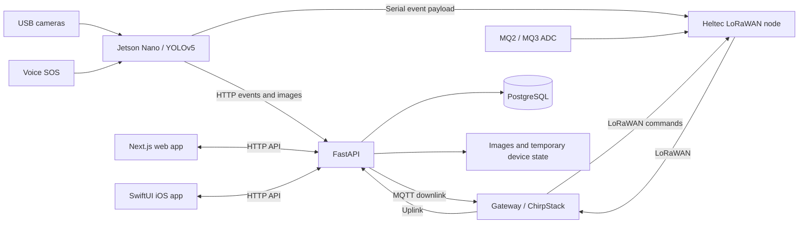

# AI-SafeGuard

**A CEE IBSP research prototype connecting edge vision, LoRaWAN sensing, a web dashboard and an iOS app.**

**English** | [繁體中文](README.zh-Hant.md)

Project author, maintainer and portfolio credit: [Cody-kin](https://github.com/Cody-kin). Cody-kin confirms sole authorship of the project-specific work and authorizes publication; third-party components retain their own authorship and licenses.

AI-SafeGuard explores safety monitoring where cameras, environmental sensors and operators must communicate across unreliable network paths. A Jetson Nano processes camera frames and voice SOS input; a Heltec node carries compact LoRaWAN messages; a FastAPI service exposes events, device configuration and analysis to Next.js and SwiftUI clients.

**Research prototype; source portfolio release.** The supplied reports describe historical demonstrations. This repository distinguishes those claims from source-code evidence and tests reproduced during review. It is not a certified safety system or a verified production deployment.

## Start with a hardware-free check

Clone the repository, then run:

```bash
git clone https://github.com/Cody-kin/cee-ibsp-ai-safeguard.git
cd cee-ibsp-ai-safeguard
python3 tools/verify.py
```

Requires Python 3.9+ and Bash. This parses Python/JSON/Shell files, checks three credential patterns and exercises eight isolated alert cases. It does not start the app, access a camera, load a model, send notifications or perform OTA. The fuller API regression suite uses Python 3.12 and temporary SQLite; see [verification](#verification-and-evidence).

## What the project contains

| Area | Implemented source | Current boundary |
| --- | --- | --- |
| Edge vision | Dual-camera processing; YOLOv5 adapter; fire, smoke, fall, phone and smoking alerts; missing-helmet/vest inference | Model weights omitted; accuracy/FPS not reproduced; PPE logic uses whole-frame presence rather than per-person matching |
| Local sensing | DF2301Q voice SOS; MQ2/MQ3 ADC values; Heltec Wireless Stick V3 firmware | Requires physical wiring/calibration; ADC values are not calibrated gas concentrations |
| Communication | HTTP event/image upload; serial LoRa messages; ChirpStack uplink and MQTT downlink | Both alert paths are attempted; no cross-path deduplication or reliable delivery ACK |
| Cloud platform | FastAPI, PostgreSQL schema, JWT login, users, events, device settings, analysis, snapshot storage and OTA file management | Regression tests use SQLite; some ingestion/read/AI routes still lack complete authentication and rate limits |
| Web application | Dashboard, camera snapshots, event history, analytics, device/LoRa controls, OTA and administration | Type checking and no-lint build pass; ESLint fails; live browser workflows not accepted end to end |
| iOS application | SwiftUI Dashboard, Events, Analytics, Devices and Settings, with OTA management and local notifications | Source/API contracts reviewed; no native build or iPhone validation; no complete APNs implementation |
| Operations | Threshold changes, START/STOP, OTA distribution, optional Telegram/Qwen integration | Unsigned OTA execution disabled by default; no signed update/rollback system; live external services untested |

The [43-feature evidence matrix](docs/FEATURE_MATRIX.md) links original report sections to code, reproduced checks and missing components. [Mobile and web workflows](docs/MOBILE_AND_WEB.md) cover the two interfaces in detail. These supporting review documents currently use Traditional Chinese.

## Architecture



Nginx routes the website, `/api` and `/storage`; Compose also declares Redis. The active backend entry point is `backend/app/main.py`. Historical root-level patch scripts and alternate entry points are retained for traceability, not as a deployment sequence. Compact LoRa events use `event_type|event_name|severity|description|mq2|mq3`. The database does not have separate columns for every telemetry/source field claimed in the report. See [architecture and contracts](docs/ARCHITECTURE.md) and the [39-route source index](docs/API_INDEX.md).

## Installation and configuration

### 1. API regression environment — reproduced

From the repository root:

```bash
python3 -m venv .venv
.venv/bin/python -m pip install -r tests/requirements.txt
.venv/bin/python -m pytest -q tests/test_regressions.py
```

The recorded run used Linux and Python 3.12.14. Direct test dependencies are pinned; this is not a full transitive dependency lock or a Jetson runtime. Tests use synthetic data, disable background services and do not contact production devices.

### 2. Web development — partial validation

```bash
cd 01_cloud_server_aegis_platform/frontend
npm ci --ignore-scripts --no-audit --no-fund
./node_modules/.bin/tsc --noEmit --incremental false
npm run lint
NEXT_TELEMETRY_DISABLED=1 ./node_modules/.bin/next build --no-lint
npm run dev
```

Run the checks individually: lint currently fails. The recorded install/type/build run used Node 24.22.1; the Dockerfile uses Node 20, which was not separately tested. Dependency lifecycle scripts are disabled during installation. `npm run dev` starts the development UI, but API-backed features need the backend and routing. It is not a standalone functional demo.

### 3. Cloud stack — deployment recipe, not validated end to end

Requires Docker with Compose. In `01_cloud_server_aegis_platform/`:

```bash
cp .env.example .env
# Edit .env before proceeding; never commit it.
docker compose config --quiet
# After resolving the known frontend lint/build issues:
docker compose up --build
```

Set unique `POSTGRES_PASSWORD`, `SECRET_KEY` and `INITIAL_ADMIN_PASSWORD`. Compose rejects missing mandatory values. `TELEGRAM_BOT_TOKEN`, `TELEGRAM_CHAT_ID` and `QWEN_API_KEY` are optional and enable integrations that were not live-tested. Do not reuse credentials from the original shared archive; rotate them with their providers.

Compose defines PostgreSQL 15, Redis 7, backend, frontend and Nginx on port 80. **Do not expose this prototype directly to the internet:** authentication gaps, plaintext HTTP defaults and unsigned-update limitations remain. Docker integration was not executed, and the standard frontend build may stop on the existing lint errors. Never run historical `patch_*`, `fix_*` or `update.sh` scripts as installation steps.

### 4. Hardware and iOS — prerequisite checklist

| Target | Required preparation |
| --- | --- |
| Jetson Nano | Compatible JetPack/CUDA/PyTorch/OpenCV; camera/serial/I2C access; separately authorized model weights and a reviewed YOLOv5 revision. The loader can fetch upstream code if no cache exists; it is not pinned. Configure `.env` from the node's `.env.example`. |
| Heltec / LoRaWAN | Matching board SDK, regional plan and gateway; replace zeroed keys/identifiers with new ones; reconcile AS923 firmware with any EU868 example configuration before use. |
| iOS | macOS/Xcode, iOS 18.2 deployment target, signing team and actual reachable server URLs. Open `IOS app/AI-SafeGuard/AI-SafeGuard.xcodeproj`; loopback examples are not a remote server. |

Hardware libraries, wiring and model provenance are not a reproducible one-command installation. Keep `ALLOW_UNSIGNED_OTA=0`; enabling it is an explicit lab-only compatibility choice, not secure OTA.

## Verification and evidence

| Check | Recorded result |
| --- | --- |
| Offline verification | 47 Python files, 10 JSON files, 4 Shell files; 8 isolated logic cases; 3 credential patterns — passed at the reviewed code baseline |
| API/protocol regression | 27 passed; 6 deprecation warnings |
| Frontend TypeScript | Passed |
| Frontend `next build --no-lint` | Passed, including generation of 14 pages |
| ESLint | Failed: existing explicit-any, unused-variable and Hooks issues |
| Docker / real PostgreSQL-MQTT / Jetson / Heltec / native iOS | Not executed |
| Model accuracy, RF range, live Telegram/Qwen and full UI workflows | Not reproduced |

The original report's 0.879 mAP and cross-floor radio measurements are historical claims, not new measurements. A successful no-lint build does not mean the standard build passes. Tests of Swift source strings do not count as native iOS tests. Exact scope and commands: [TESTING](docs/TESTING.md).

## Repository map and documentation

```text
01_cloud_server_aegis_platform/  FastAPI, Next.js, Compose and Nginx
02_jetson_nano_ai_node/          Vision, voice, local streams and communications
aegis_node1_lorawan_final/      Heltec firmware
05_chirpstack_lorawan_config/   Gateway/MQTT/ChirpStack examples
IOS app/                       Xcode project and SwiftUI application
archive/                       Inactive alternative implementation for traceability
tests/                         Synthetic regression suite
tools/                         Offline verification
docs/                          Evidence, architecture, review and rights records
```

- [Feature evidence](docs/FEATURE_MATRIX.md), [architecture](docs/ARCHITECTURE.md), [mobile/web](docs/MOBILE_AND_WEB.md)
- [Executed tests](docs/TESTING.md), [repairs and remaining issues](docs/REVIEW.md)
- [Per-file hashes](docs/SOURCE_INDEX.md), [original document hashes](docs/SOURCE_EVIDENCE.json)
- [Publication clearance review](docs/PUBLICATION_REVIEW.md), [third-party inventory](docs/THIRD_PARTY_NOTICES.md), [copyright preparation](docs/COPYRIGHT_PREPARATION.md)

## Attribution, rights and publication

**Project author / portfolio credit: Cody-kin.** The author confirms the IBSP was completed individually, is not subject to school/placement publication restrictions, and authorizes this release. Third-party drivers, fonts and template assets retain their upstream notices in `licenses/`; see [THIRD_PARTY_NOTICES](docs/THIRD_PARTY_NOTICES.md). Public availability does not grant a new project-wide open-source license.

Original reports, student IDs, assessments, signatures, training photographs, model weights, the approximately 2 GB dataset, old Git history and source credentials are excluded. The OneDrive originals remain unchanged. A fresh publication history uses GitHub's noreply email; the previous repository and its personal-email commits are retained privately, not made public with this release.

Copyright registration has **not** been submitted or completed. The preparation document lists official routes and facts needed from the rights holder. To report a defect, provide a synthetic reproduction and versions; never attach real keys, student records or identifiable footage. Changes should update both README languages and state precisely which tests were run.
