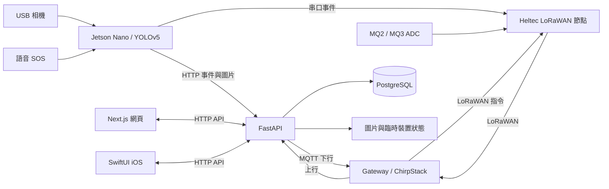

# AI-SafeGuard

**結合邊緣影像辨識、LoRaWAN 感測、網頁儀表板與 iOS App 的 CEE IBSP 研究原型。**

[English](README.md) | **繁體中文**

專案作者、維護者與作品集署名：[Cody-kin](https://github.com/Cody-kin)。Cody-kin 確認專案原創部分由其一人完成並授權公開；第三方元件保留各自作者與授權。

AI-SafeGuard 探索網路不穩定環境中的安全監察：Jetson Nano 處理相機影像與語音 SOS，Heltec 節點傳送精簡 LoRaWAN 訊息，FastAPI 提供事件、裝置設定及分析，讓 Next.js 網頁與 SwiftUI App 呈現現場狀態。

**目前是研究原型與源碼作品集發布版。** 原報告描述的是歷史展示；本倉庫將報告聲稱、程式存在與本次實測分開列出，並非安全認證產品或已驗收的生產部署。

## 先做不需硬件的檢查

取得倉庫：

```bash
git clone https://github.com/Cody-kin/cee-ibsp-ai-safeguard.git
cd cee-ibsp-ai-safeguard
python3 tools/verify.py
```

需要 Python 3.9+ 與 Bash。此步解析 Python／JSON／Shell、掃描三類憑證格式並執行八個隔離警報案例；不啟動應用、相機、模型、通知或 OTA。較完整的 API 測試使用 Python 3.12 與臨時 SQLite，見下方驗證章節。

## 功能與目前範圍

| 模組 | 已有程式 | 實際限制 |
| --- | --- | --- |
| 邊緣影像 | 雙相機處理、YOLOv5、火／煙／跌倒／電話／吸煙、缺帽／缺反光衣推論 | 未附模型，未重測準確率／FPS；PPE 為全畫面存在性判斷，未逐人配對 |
| 現場感測 | DF2301Q 語音 SOS、MQ2/MQ3 ADC、Heltec Wireless Stick V3 韌體 | 需真實接線及校準；ADC 不是氣體濃度 ppm |
| 通訊 | HTTP 事件／圖片、串口 LoRa、ChirpStack 上行、MQTT 下行 | 兩路都嘗試發送，無跨通道去重或可靠收件 ACK |
| 雲端 | FastAPI、PostgreSQL schema、JWT、使用者／事件／裝置／分析、圖片與 OTA 檔案管理 | 測試使用 SQLite；部分輸入／讀取／AI 路由仍缺完整認證與限流 |
| 網頁 | 總覽、圖片、事件、分析、裝置／LoRa、OTA、管理設定 | 型別與略過 lint 建置通過；lint 失敗；未驗收真實瀏覽器全流程 |
| iOS | Dashboard、Events、Analytics、Devices、Settings，含 OTA 管理及本地通知 | 已對照源碼/API，未原生編譯或 iPhone 驗證；未有完整 APNs |
| 維護 | 閾值調整、START/STOP、OTA、可選 Telegram/Qwen | 未簽章 OTA 預設禁用；缺簽章／回滾；外部服務未實測 |

[43 項功能證據表](docs/FEATURE_MATRIX.md)逐項連結原報告與程式、測試和缺漏；[iOS／網頁導覽](docs/MOBILE_AND_WEB.md)補充跨端操作流程。

## 系統架構



Nginx 分流網站、`/api`、`/storage`；Compose 另定義 Redis。活動後端入口是 `backend/app/main.py`，根目錄歷史修補腳本不是部署順序。LoRa 精簡事件格式為 `event_type|event_name|severity|description|mq2|mq3`。資料庫沒有原報告所述全部遙測／來源欄位，詳見[架構與資料契約](docs/ARCHITECTURE.md)、[39 個 API 路由索引](docs/API_INDEX.md)。

## 安裝與設定

### 1. API 測試環境：已重現

在倉庫根目錄：

```bash
python3 -m venv .venv
.venv/bin/python -m pip install -r tests/requirements.txt
.venv/bin/python -m pytest -q tests/test_regressions.py
```

記錄環境為 Linux、Python 3.12.14。測試直接依賴已鎖版，但不是完整傳遞依賴鎖檔或 Jetson 環境。測試使用合成資料、關閉背景服務，不連接正式裝置。

### 2. 網頁開發：部分驗證

```bash
cd 01_cloud_server_aegis_platform/frontend
npm ci --ignore-scripts --no-audit --no-fund
./node_modules/.bin/tsc --noEmit --incremental false
npm run lint
NEXT_TELEMETRY_DISABLED=1 ./node_modules/.bin/next build --no-lint
npm run dev
```

請逐項執行；lint 目前會失敗。本次安裝／型別／建置使用 Node 24.22.1，Dockerfile 的 Node 20 未另測。安裝停用依賴 lifecycle scripts。`npm run dev` 可啟動開發 UI，但需後端與路由才有資料功能，不是獨立可用展示。

### 3. 雲端服務：部署配方，尚未端到端驗收

需要 Docker 與 Compose。在 `01_cloud_server_aegis_platform/`：

```bash
cp .env.example .env
# 先編輯 .env，不要提交此檔。
docker compose config --quiet
# 修復現有前端 lint／建置阻礙後：
docker compose up --build
```

設定獨立的 `POSTGRES_PASSWORD`、`SECRET_KEY`、`INITIAL_ADMIN_PASSWORD`，缺值時 Compose 會拒絕啟動。`TELEGRAM_BOT_TOKEN`、`TELEGRAM_CHAT_ID`、`QWEN_API_KEY` 是選用且未實測的整合；不可沿用原共享檔的憑證，需向相關服務輪替。

Compose 包含 PostgreSQL 15、Redis 7、前後端及 port 80 Nginx。**目前不要直接暴露到網際網路：** 尚有認證缺口、明文 HTTP 和 OTA 限制。Docker 整合未執行，標準前端 build 仍可能因 lint 失敗。歷史 `patch_*`、`fix_*`、`update.sh` 不是安裝步驟。

### 4. 硬件與 iOS 準備

| 目標 | 所需條件 |
| --- | --- |
| Jetson Nano | 相容 JetPack/CUDA/PyTorch/OpenCV、相機／串口／I2C、另行授權的模型及已核對 YOLOv5 版本。loader 無快取會嘗試下載上游程式，尚未鎖定版本。依節點 `.env.example` 設定 `.env`。 |
| Heltec／LoRaWAN | 對應板卡 SDK、區域頻段及閘道；換掉全零金鑰／識別；部署前核對 AS923 韌體與 EU868 範例設定。 |
| iOS | macOS/Xcode、iOS 18.2 目標、簽章團隊與可連線的測試伺服器。開啟 `IOS app/AI-SafeGuard/AI-SafeGuard.xcodeproj`；loopback 範例不會連到遠端伺服器。 |

接線、硬件驅動與模型來源尚不構成一鍵重現安裝。保持 `ALLOW_UNSIGNED_OTA=0`；改為 1 只是明確啟用實驗室相容行為，不是安全 OTA。

## 驗證結果與證據

| 檢查 | 已記錄結果 |
| --- | --- |
| 離線檢查 | 審查基準的 47 Python、10 JSON、4 Shell；8 邏輯案例；3 憑證格式，通過 |
| API／協定回歸 | 27 passed；6 項棄用警告 |
| 前端 TypeScript | 通過 |
| `next build --no-lint` | 通過，生成 14 頁 |
| ESLint | 失敗：既有 explicit-any、unused-vars 與 Hooks 問題 |
| Docker／真實 PostgreSQL-MQTT／Jetson／Heltec／原生 iOS | 未執行 |
| 模型準確率、RF 範圍、Telegram/Qwen、完整 UI 操作 | 未重現 |

原報告 0.879 mAP 與跨樓層 RF 數字是歷史聲稱，不是本次量測。略過 lint 建置成功不代表標準建置通過；Swift 字串檢查不是原生測試。詳細命令及範圍見 [TESTING](docs/TESTING.md)。

## 目錄與文件

```text
01_cloud_server_aegis_platform/  FastAPI、Next.js、Compose、Nginx
02_jetson_nano_ai_node/          影像、語音、本地串流及通訊
aegis_node1_lorawan_final/      Heltec 韌體
05_chirpstack_lorawan_config/   Gateway/MQTT/ChirpStack 範例
IOS app/                       Xcode 專案與 SwiftUI App
archive/                       非活動替代實作，供追溯
tests/                         合成資料回歸測試
tools/                         離線檢查
docs/                          證據、架構、審查及權屬記錄
```

- [功能對照](docs/FEATURE_MATRIX.md)、[架構](docs/ARCHITECTURE.md)、[iOS／網頁](docs/MOBILE_AND_WEB.md)
- [測試](docs/TESTING.md)、[修復與限制](docs/REVIEW.md)
- [逐檔雜湊](docs/SOURCE_INDEX.md)、[原始文件雜湊](docs/SOURCE_EVIDENCE.json)
- [公開前審查](docs/PUBLICATION_REVIEW.md)、[第三方清單](docs/THIRD_PARTY_NOTICES.md)、[版權登記準備](docs/COPYRIGHT_PREPARATION.md)

## 署名、授權與公開狀態

**專案作者／作品集署名：Cody-kin。** 作者確認 IBSP 由其一人完成，與學校／實習機構公開限制無關，並授權本次發布。第三方驅動、字型及範本素材保留上游聲明，授權原文位於 `licenses/`，詳見[第三方清單](docs/THIRD_PARTY_NOTICES.md)。公開可讀不代表新增全專案開源授權。

原報告、學號、評核、簽名、訓練人物圖片、模型、約 2 GB 資料集、舊 Git 歷史與原始憑證未發布；OneDrive 原件未變動。發布版本使用 GitHub noreply 郵箱的新提交歷史；包含私人郵箱的舊倉庫保留私人，不隨本次發布公開。

版權登記**未提交、未完成**。準備文件列有官方途徑與待確認事實。回報問題請提供版本及合成重現資料，不要附真實憑證、學生記錄或可識別影像。修改時應同步兩種 README，明確記錄實際執行的驗證。
