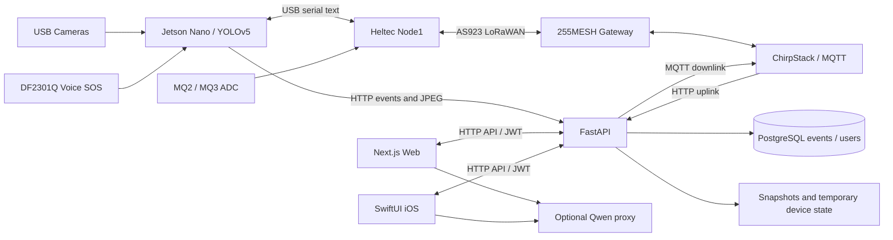

# 系統架構與資料流

AI-SafeGuard 有五個主要軟件模組：Jetson 邊緣偵測、Heltec 韌體、ChirpStack 通訊、FastAPI/Next.js 雲端、SwiftUI iOS。Web 與 iOS 共用雲端 API，並非獨立資料庫或兩套偵測系統。

## 核心契約

- 事件：HTTP multipart，`device_id/event_type/event_name/severity/description`，可選 `image`。資料庫目前只有這些欄位與 timestamp；報告提到的 MQ、source、snapshot path 並非獨立 DB columns。MQ 數據編碼於 description 或 LoRa latest JSON。
- 相機：JPEG POST `/api/v1/stream/{device_id}/{camera_id}`、GET 同一路徑；不是持續 WebRTC 視訊。Nano 心跳傳 active camera IDs 並取得閾值。
- LoRa：`event_type|event_name|severity|description|mq2|mq3`；資料量限制意味沒有圖片。`parse_node2_payload` 的文字附註是 `[Gas:mq3/mq2]`。UI 中又存在 swapped-channel 假設，硬件通道對應未核實，不能把 raw ADC 顯示值當已校準濃度。
- 控制：`CFG|camera|fire,smoke,fall,hardhat,vest,smoking,phone` 或 `SYS|START/STOP/OTA_SCRIPT`。管理員 API 寫入單一 pending.txt，下一次 LoRa uplink 嘗試 MQTT 下行。這不是可靠多命令佇列；publish 成功不等於節點確認。
- 偵測：五類直接危險加兩類 PPE 缺失推導，七種 safety checks 並非七個原始模型 classes。缺 PPE 是全畫面 heuristic，目前沒有逐人追蹤。

## 執行入口與狀態

| 模組 | 入口 | 狀態與儲存 |
| --- | --- | --- |
| Cloud | backend Dockerfile → `app.main:app` | PostgreSQL、storage；devices/LoRa/OTA 部分狀態放 /tmp，容器重建不保證保留 |
| Web | Next.js `src/app/layout.tsx` 與各 page | localStorage token/偏好、Zustand、輪詢 API |
| Jetson | `main.py` | camera threads、NetworkManager、LoRaManager、AudioDetector；缺外部 best.pt |
| Firmware | `.ino` setup/loop | OTAA session、OLED、ADC、serial、短文字 uplink |
| iOS | `AI_SafeGuardApp.swift` → `MainTabView` | DashboardViewModel 共用輪詢；UserDefaults token/偏好；本地通知 |

## 部署邊界

本次只在隔離 SQLite 執行 HTTP API 測試；未部署外網服務、未連原有伺服器。前端與 iOS 相機讀取權限仍不完整，Next AI/OTA history 代理仍有未授權讀寫風險。新增的管理員保護只覆蓋明列的寫入與 OTA 管理路由，不能描述成全系統 RBAC 完成。

原 ZIP 的根 `main.py`、修補腳本、備用 settings router、舊 comms_manager 不是 Docker 目前的主入口。保留它們是為追溯，不能自動當 migration 執行。原報告附錄中的 `03_heltec...`、`04_ios_application`、`06_ota_and_scripts` 及 CLEAN.zip 名稱與實際提供的 ZIP 不完全相同；本倉庫維持既有可解析路徑，透過文件索引建立專業導航，而非假設缺少的打包內容存在。
